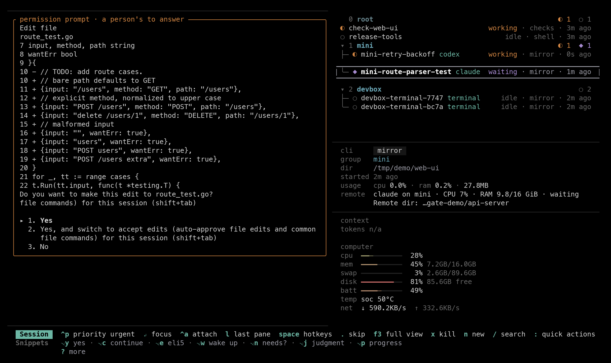
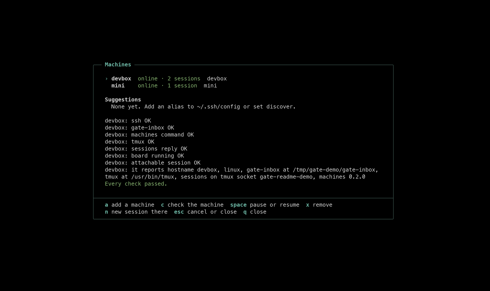
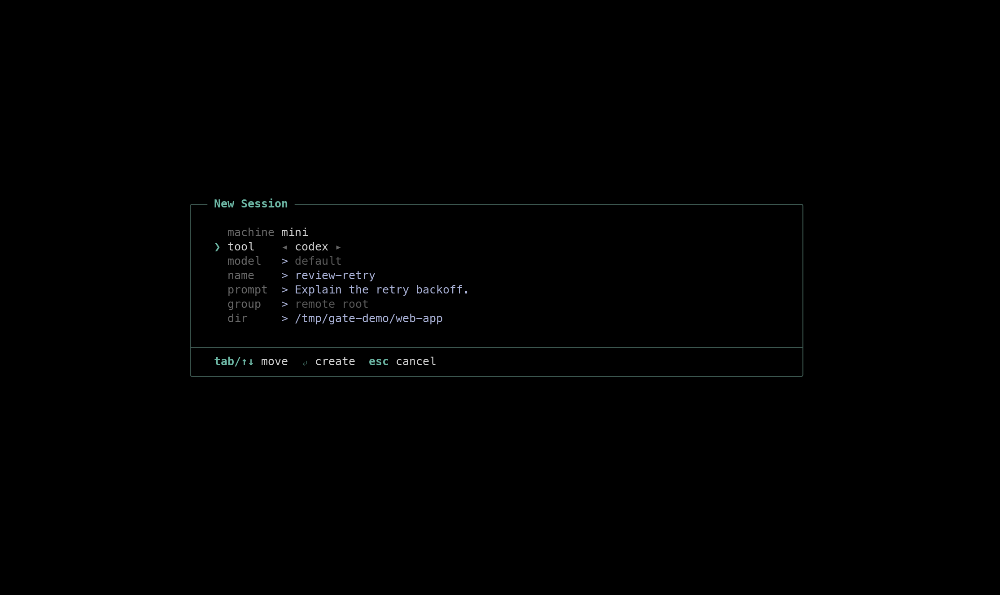
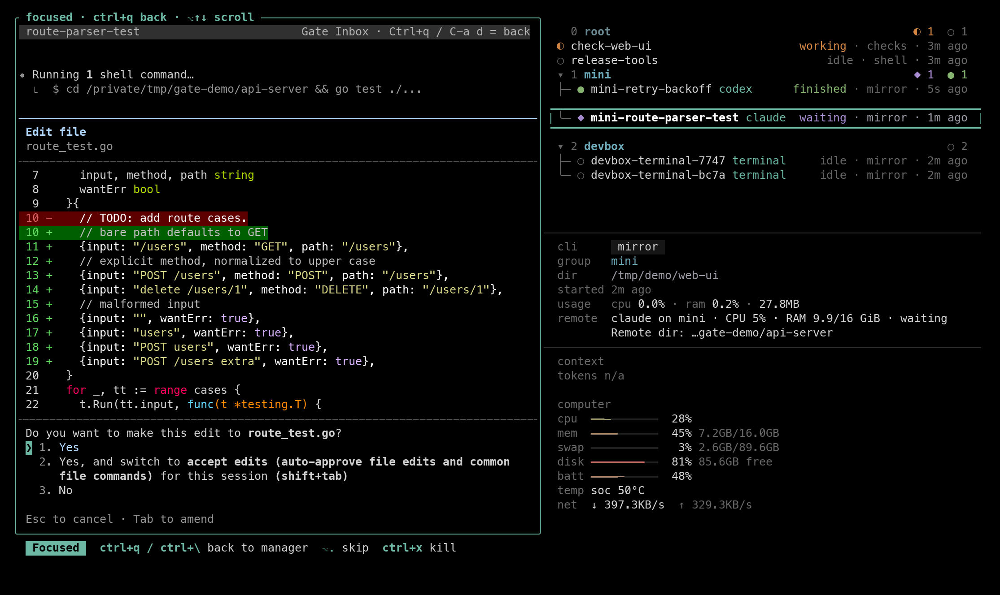

# Gate Inbox Machines

Running agents on several machines usually means several Gate Inbox boards, SSH windows, and queues to check. Gate Inbox Machines brings those sessions into one [Gate Inbox](https://github.com/usestring/gate-inbox) board. A mirror shows the status reported by the worker, joins your local triage queue when available, and opens the worker's terminal when you select it.

This is a prototype of multi-machine support. It builds on stock Gate Inbox v1.1.0 through the public `extension` package only, with no core patches. Where that API stops, [Known limits](#known-limits) says so and [the API notes](docs/extension-limits.md) describe the change in Gate Inbox that would lift the limit.

## Screenshots



One board with local sessions and mirrors from two workers, `mini` and `devbox`, filed in a group per machine. The selected Claude session on `mini` is waiting on a permission prompt. Its `remote` line shows the worker's CPU, RAM and directory.



The machines screen (`O`) shows each worker's state. `c` runs the same step-by-step check as `gate-inbox machines check`.



`N` starts an agent or a shell on a worker, after loading the CLIs installed there.



Enter opens the mirror, which is the agent's own terminal on `mini`, attached over SSH. Answer the prompt there.

## Quick start

1. Install this build on the controller and each worker. Building it requires Go 1.27.3 or later. Gate Inbox needs tmux 3.1 or later, git, and the agent CLI you want to run. The extension uses stock Gate Inbox v1.1.0.

   ```sh
   go install github.com/hung-ng/gate-inbox-machines/cmd/gate-inbox@latest
   ```

2. Start Gate Inbox on each worker. A worker can keep running the stock board as long as the extension build is also installed for SSH commands. If you keep both binaries, point the controller at the extension build. Both builds can use your existing board home.
3. Set up SSH key access from the controller and make sure `ssh user@devbox.example.com true` works without a prompt. Start the extension build on the controller, press `O`, then `a` to add the worker. You can also add and check it from your shell.

   ```sh
   gate-inbox machines add user@devbox.example.com
   gate-inbox machines check
   ```

4. Wait for running worker sessions to appear. Select a mirror and press Enter to use its terminal.

Use an SSH alias, hostname, or `user@host`. If a check fails, follow the command or fix it prints and retry. Press `T` to open a terminal from the board.

## How it works

The **controller** is the board you use to watch and triage sessions. Each **worker** runs its own board, which still owns its agents, reads their panes, and detects their status. The controller runs `gate-inbox machines sessions --json` over SSH for each worker, by default every three seconds. Each reply carries session status, tmux details, and available CPU and RAM readings. The controller computes CPU usage from the change in counters between polls.

Each eligible remote session gets a local mirror row. Its pane runs SSH and attaches to the worker's `gi_<id>` tmux session. The extension pins the row's status from the worker's reply. SSH uses `ControlMaster` by default so polls and mirror panes can share a connection. The extension runs no network listener.

## Use the board

| Key | Action |
| --- | --- |
| `O` | Open the machines screen |
| `N` | Start a session on a worker |
| Enter | Open the selected mirror terminal |
| `ctrl+q` | Leave the focused mirror or advance triage |
| `ctrl+\` | Return to the list |
| `v` | Revive a dead mirror pane |
| `alt+x` | Open the confirmation to dismiss a mirror |

The key map (`h`) and Quick Actions (`:`) list the extension's board actions. When a mirror is waiting, open its terminal to read and answer the question. If the remote pane enters tmux scroll mode, press `q` inside the mirror to leave it.

When you press `N`, choose a worker and press Enter to load the CLIs installed there. With one unpaused worker, the board selects it and checks its CLIs automatically. An agent can take a model, name, first task, remote group, and working directory. **Terminal** takes a directory and opens a shell on the worker's tmux server. It appears as a mirror. Type `exit` in the shell to end it. The tool check and launch use the worker's login shell.

Restarting the controller board leaves mirror panes running. If SSH drops, an open mirror retries with delays up to 10 seconds. Dismissing a mirror closes and archives the local pane. The remote session keeps running. The row stays dismissed until you restore it or the worker reports that the session has ended. To restore it, open the archive from Quick Actions, press `u` on the row, and confirm.

Offline, stopped, and paused workers keep their mirror rows and last status. Those mirrors stay out of triage. The row badge and the selected row's `remote` details show the worker state and, when available, the remote directory and CPU and RAM readings. The last reading is marked stale if the controller stops receiving stats. The `computer` meters show the machine running the board.

### Manage workers

| Key on the machines screen | Action |
| --- | --- |
| `a` | Add a machine |
| Enter | Check the selected machine or fill the add form from a suggestion |
| `c` | Check the selected machine |
| Space | Pause or resume polling |
| `n` | Start a session on the selected machine |
| `x` | Remove the machine. Press `y` or Enter to confirm, or Esc to cancel |

Removing a worker archives its mirrors and leaves the worker's sessions running. Suggestions come from concrete hosts in `~/.ssh/config` and the optional `discover` command. The add form checks SSH when you submit it.

Only the SSH destination is required. You can also give the worker a name or file its mirrors in an existing local group. Use `g` on the main list to create a group. Press Alt+a in the add form to show **Board home**, for a worker that sets `GATE_INBOX_HOME`, and **Binary path**, for a different binary name or location on the worker. Run `gate-inbox machines add --help` for the CLI options.

The CLI also provides `machines list`, `pause`, `resume`, and `remove`. Run commands that change the machine registry from an operator terminal outside a Gate Inbox session. With no machine names, `machines check` checks all unpaused machines.

## Settings

Set these under `[extensions.machines]` in the controller's `config.toml`.

| Key | Default | Purpose |
| --- | --- | --- |
| `poll` | `"3s"` | Poll interval, with a minimum of one second |
| `ssh` | `["ssh"]` | SSH executable and any extra options |
| `control_path` | `/tmp/gate-inbox-machines-<uid>/%C` | Shared SSH socket path. Use a directory you own with mode 0700, or set `"none"` to disable sharing |
| `discover` | unset | Command that prints one suggested SSH destination per line |

Machine entries live in `extensions/machines/machines.json` under the controller's config directory. If you have old `[extensions.machines.<name>]` tables, remove them and add the workers through the machines screen or CLI.

Registry edits take effect on the next poll. Restart the controller after editing `[extensions.machines]`. A running mirror keeps the SSH settings it started with. Kill the local pane and press `v` to pick up new SSH settings. Each reconnect rereads the machine entry and its learned tmux settings.

On the worker, `tmux_socket` in `config.toml` takes precedence over `GATE_INBOX_TMUX_SOCKET` and tmux's default socket. If you only set the environment variable, make it available to the worker's SSH command on first discovery.

Uncheck `mirror` in **Settings → CLIs** to hide it in both local launch pickers. Use `N` to start a new remote session.

## Known limits

- Mirrors are local rows with their own lifecycle. The stock preview recognizes a dialog that is on the mirror pane's screen and shows it as a card, but it has no remote conversation history and no structured question data, so a wrapped line can show twice. Snippet keys and `r` can type into the pane while a dialog is out of view. Use Enter to read and answer in the remote terminal.
- A pane adopted in place usually has no `gi_<id>` tmux session, so the controller cannot mirror it. Press `a` on the worker board to relaunch it as a board session once idle.
- Status arrives on the next successful poll. A worker board must be running for fresh agent status.
- On macOS, an agent that needs the login keychain may need its tmux server started from the desktop session. For example, run `tmux -L agents start-server \; set -s exit-empty off` there before spawning over SSH, using the same socket as the worker board. For the default socket, omit `-L agents`.

See [the Gate Inbox v1.1.0 API notes](docs/extension-limits.md) for the source behind these limits and changes that could address them upstream.

## Development

Install tmux and zsh to exercise the tmux and shell tests. Run the same build, vet, format, and race checks used by CI.

```sh
GOWORK=off go build ./cmd/gate-inbox
GOWORK=off go vet ./...
test -z "$(gofmt -l .)"
env -u TMUX -u TMUX_PANE TMUX_TMPDIR="$(mktemp -d)" GOWORK=off go test -race ./...
```

## License

[Apache-2.0](LICENSE).
